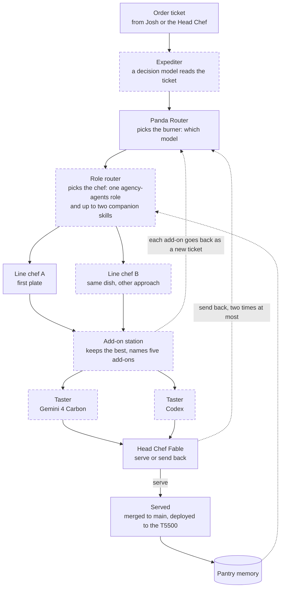
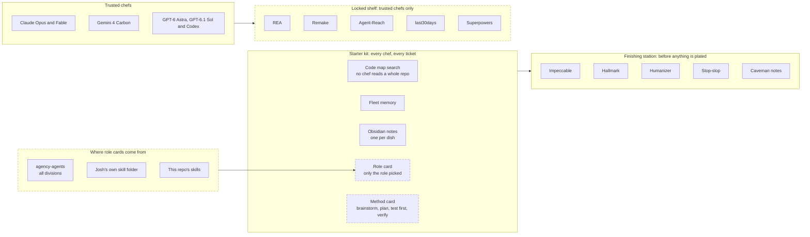
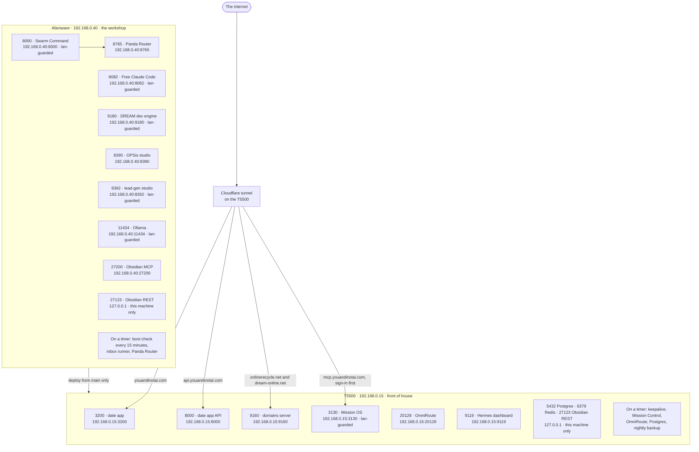
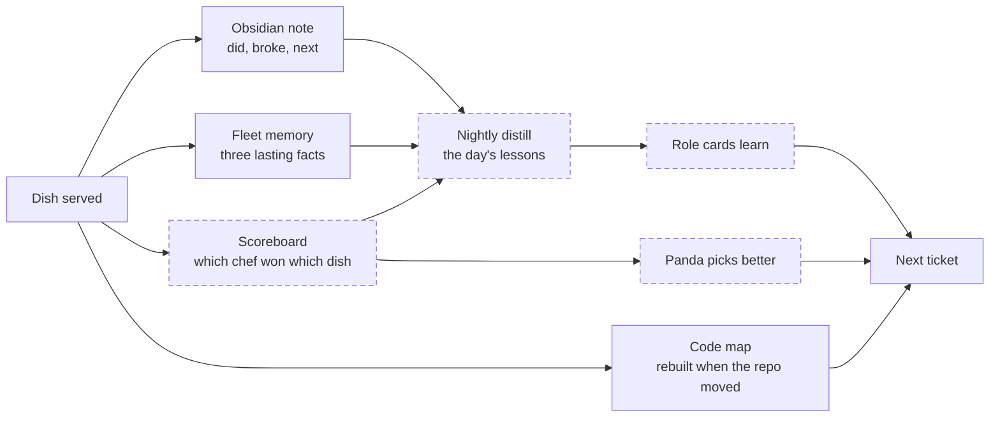

# Fable's Kitchen: the recipes in pictures

Every change to this repo is cooked in one kitchen. There is one head chef, a line of chefs from different AI companies, a pantry of memory, and two tasters before anything is served.

How to read the pictures: solid boxes run today. Dashed boxes are being built.

## 1. The line: how one ticket becomes a served dish

Running today: tickets land in the wheel's inbox; the Panda Router picks the model; one line chef cooks; Head Chef Fable reads the work and the real screens, then merges or sends it back; main is deployed to the T5500; every dish leaves notes in the pantry.

Being built: the Swarm Command request box that writes tickets into the inbox, the expediter, the role router, the second plate, the add-on station and the two tasters.

## 2. The pantry: what every chef can reach

Running today: the code map, fleet memory and the Obsidian note for every task. The role cards, the method card and the locked shelf as one starter kit are being built. The roster of roles already holds 347 entries.

Remake rule: a remake is a study copy. It stays on the machine that made it, is recoloured dark, gets new icons, routing and memory, and has any sign-in removed. Nothing from a remake is served as a copy.

## 3. The kitchens: machines, ports and what runs on a timer

Every address is written the way the house requires (`docs/house/ADDRESS-DOCTRINE.md` and `ops/fleet/fleet-map.json`): `192.168.0.40` (Alienware) or `192.168.0.15` (T5500) and the port, never a loopback reach URL. Guarded LAN services require their token check and firewall allowlist. Postgres (`5432`), Redis (`6379`) and Obsidian Local REST (`27123`) stay on `127.0.0.1` (`this machine only`), on purpose.

## 4. The memory loop: why the kitchen gets better every day

Running today: the note, fleet memory and the code map. The scoreboard, the nightly distill and the learning role cards are being built.
